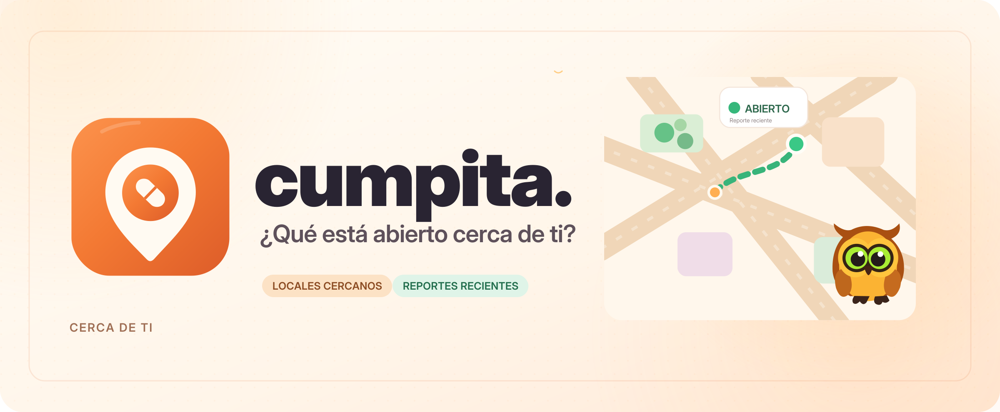

<div align="center">

<picture>
  <source media="(prefers-color-scheme: dark)" srcset="branding/cumpita-banner-oscuro.png" />
  
</picture>

# cumpita.

**Saber qué está abierto cerca, con información reciente.**

[](#sobre-el-proyecto) [](#usar-o-descargar) [](LICENSING.md)

[](#tecnologías) [](#tecnologías) [](#tecnologías) [](#tecnologías)

[Abrir aplicación](https://cumpita.lovable.app) · [Releases y descargas](https://github.com/NicoCG32/cumpita/releases/tag/v1.0.0) · [Documentación](docs/README.md) · [Arquitectura](docs/01-arquitectura-general.md) · [Inicio rápido](#ejecutar-desde-el-código)

</div>

---

## Sobre el proyecto

Aplicación comunitaria para consultar locales cercanos y su estado de apertura en Calama, La Serena y Coquimbo. Combina fuentes públicas con confirmaciones recientes de vecinos para ayudar a decidir dónde ir.

**Estado:** Piloto web/PWA. La distribución Android está planificada; la release de fuentes y notas todavía no incluye una APK.

## Tecnologías

| Área                    | Tecnologías y responsabilidad                                                     |
| ----------------------- | --------------------------------------------------------------------------------- |
| **Interfaz y servidor** | React 19, TypeScript, TanStack Start y Tailwind CSS.                              |
| **Datos y cuentas**     | Supabase/PostgreSQL, autenticación y Realtime.                                    |
| **Servicios**           | Leaflet y OpenStreetMap/Overpass; turnos de farmacias y Firebase Cloud Messaging. |

> **Enfoque técnico:** Fuentes externas y reportes recientes; las funciones de servidor requieren backend.

## Usar o descargar

[Abrir la aplicación](https://cumpita.lovable.app) · [Release 1.0.0: fuentes y notas](https://github.com/NicoCG32/cumpita/releases/tag/v1.0.0). Elige ciudad o ubicación, busca un local y revisa la fuente y antigüedad de su estado.

## Ejecutar desde el código

Con Bun y el entorno del backend configurado según la [guía de instalación](docs/09-instalacion-y-despliegue.md), desde la raíz:

```sh
bun install --frozen-lockfile
bun run dev
```

Abre la dirección indicada por Vite. Las funciones de servidor necesitan sus servicios y configuración; una copia estática no los reemplaza.

## Documentación

[Índice completo y rutas de lectura](docs/README.md) · [Recorrido de uso](docs/03-flujo-de-usuario.md).

| Tipo       | Lectura                                                                                                                                                                          |
| ---------- | -------------------------------------------------------------------------------------------------------------------------------------------------------------------------------- |
| General    | [Problema, cliente y solución](docs/00-problematica-cliente-y-valor.md) · [Motivación](docs/16-motivacion-y-contexto.md)                                                         |
| Técnica    | [Arquitectura y diagramas](docs/01-arquitectura-general.md) · [Dominio y datos](docs/04-base-de-datos.md)                                                                        |
| Desarrollo | [Etapas y metodología](docs/17-desarrollo-y-metodologia.md) · [Proyección](docs/15-escalabilidad-y-nuevos-mercados.md) · [Costos CLP/USD](docs/18-analisis-economico-clp-usd.md) |

[Identidad visual](branding/README.md): logos, banners y variantes de aplicación.

## Licencia y créditos

Código y documentación propios: [PolyForm Noncommercial 1.0.0](LICENSE), con [atribución](NOTICE). Uso comercial fuera de sus permisos: acuerdo previo de créditos y compensación. [Alcance y contacto](LICENSING.md).
