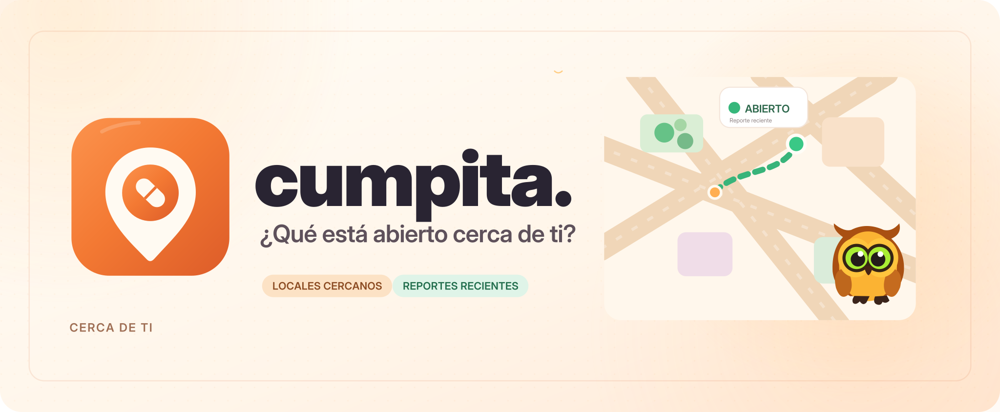

<div align="center">

<picture>
  <source media="(prefers-color-scheme: dark)" srcset="branding/banners/cumpita-banner-oscuro.svg" />
  
</picture>

# cumpita.

**Antes de salir, averigua si vale la pena el pique.**

Una web instalable para encontrar comercios cercanos y contrastar sus horarios con lo que otros acaban de observar.

[Probar la web](https://cumpita.lovable.app) · [Explorar la documentación](docs/README.md) · [Entender la arquitectura](docs/tecnica/01-arquitectura.md) · [Licencia](LICENSING.md)

</div>

## Resumen ejecutivo

Cumpita es una web instalable (PWA) para encontrar comercios cercanos en Calama, La Serena y Coquimbo. Combina horarios, farmacias de turno y reportes comunitarios para ayudar a decidir dónde comprar y reducir viajes innecesarios. Permite aportar sin crear una cuenta y consultar la fuente y antigüedad de cada dato. El proyecto está en fase piloto.

## Estado real del proyecto

| Nivel | Alcance de esta versión |
| --- | --- |
| ✅ **Implementado** | PWA para explorar comercios, consultar horarios y farmacias de turno, guardar favoritos y aportar reportes comunitarios **sin crear cuenta**. |
| 🧪 **En validación** | Cobertura y actualidad de datos externos, moderación/calidad de reportes, permisos del dispositivo y funcionamiento de avisos en navegadores compatibles. |
| 🧭 **Evolución futura** | Extensiones territoriales y automatizaciones sujetas a las prioridades del proyecto; no se presumen ya desplegadas ni verificadas. |

<details>
<summary><strong>¿Cómo leer este estado?</strong></summary>

«Implementado» significa que hay código o una entrega identificable; no equivale por sí solo a una prueba exhaustiva. «En validación» señala pruebas y límites todavía abiertos. «Propuesto» describe una intención, **no una función disponible**. Para evaluación técnica, consulta los documentos y las releases de cada versión.

</details>

## De dónde salió

Cumpita nació de algo que me comentó mi padre: a veces uno sale a comprar y recién al llegar descubre que el negocio está cerrado. Quise hacer una herramienta que respondiera una pregunta simple: **¿hay algo abierto cerca, ahora?**

Es un proyecto personal e independiente que desarrollo con **Lovable**, planteando cambios, probando el resultado y ajustándolo. Quiero que consultar y aportar sean igual de sencillos: quien está frente a un local puede avisar si lo encontró abierto o cerrado sin registrarse.

## Qué puedes hacer

- Buscar comercios por categoría, ubicación y distancia, en lista o mapa.
- Consultar horarios, turnos de farmacia y reportes recientes de abierto o cerrado.
- Aportar reportes, etiquetas y propuestas de horarios o locales.
- Guardar favoritos y compartir la ficha de un comercio.
- Instalar la PWA y activar avisos en navegadores compatibles.

La [guía de uso](docs/general/02-experiencia-de-uso.md) explica los permisos y condiciones de cada función.

## Tecnologías

**React 19 + TypeScript + TanStack Start** para interfaz y funciones de servidor; **Tailwind CSS 4** para los estilos; **Supabase/PostgreSQL** para autenticación, reportes, propuestas y persistencia; **Leaflet/OpenStreetMap** para el mapa; datos de **Overpass**, **MINSAL**, turnos obtenidos desde una fuente externa y, de forma opcional, **Google Places**. Las notificaciones web utilizan **Firebase Cloud Messaging** a través de un conector.

## Empezar

Con los servicios y variables configurados según la [guía de desarrollo](docs/desarrollo/01-entorno-y-despliegue.md):

```sh
bun install --frozen-lockfile
bun run dev
```

Los controles locales habituales son `bun run test`, `bun run lint`, `bunx tsc --noEmit` y `bun run build`. El `.env` versionado conserva la configuración pública de Lovable; los secretos del servidor se gestionan por separado según la guía de desarrollo.

## Leer la documentación

- **[General](docs/general/01-origen-y-alcance.md):** por qué hice Cumpita, qué puede hacer una persona y qué significa su información.
- **[Técnica](docs/tecnica/01-arquitectura.md):** arquitectura, diagramas, datos, reglas, integraciones y límites de seguridad.
- **[Desarrollo](docs/desarrollo/01-entorno-y-despliegue.md):** ponerlo en marcha, operarlo, probarlo y decidir cómo continuar.

El [índice](docs/README.md) reúne las guías. Las [releases](https://github.com/NicoCG32/cumpita/releases) distribuyen código fuente y notas de versión; la web se publica por separado.

## Autoría

Desarrollado por **Pablo Guzmán**, con **Lovable** como herramienta principal.

## Identidad y condiciones de uso

Los recursos gráficos están en [`branding/`](branding/README.md); los banners claro y oscuro se adaptan a GitHub sin cargar ambos al mismo tiempo. El código se distribuye con las condiciones descritas en [LICENSE](LICENSE), [LICENSING.md](LICENSING.md) y [NOTICE](NOTICE). Lee esos archivos antes de reutilizarlo o redistribuirlo.
