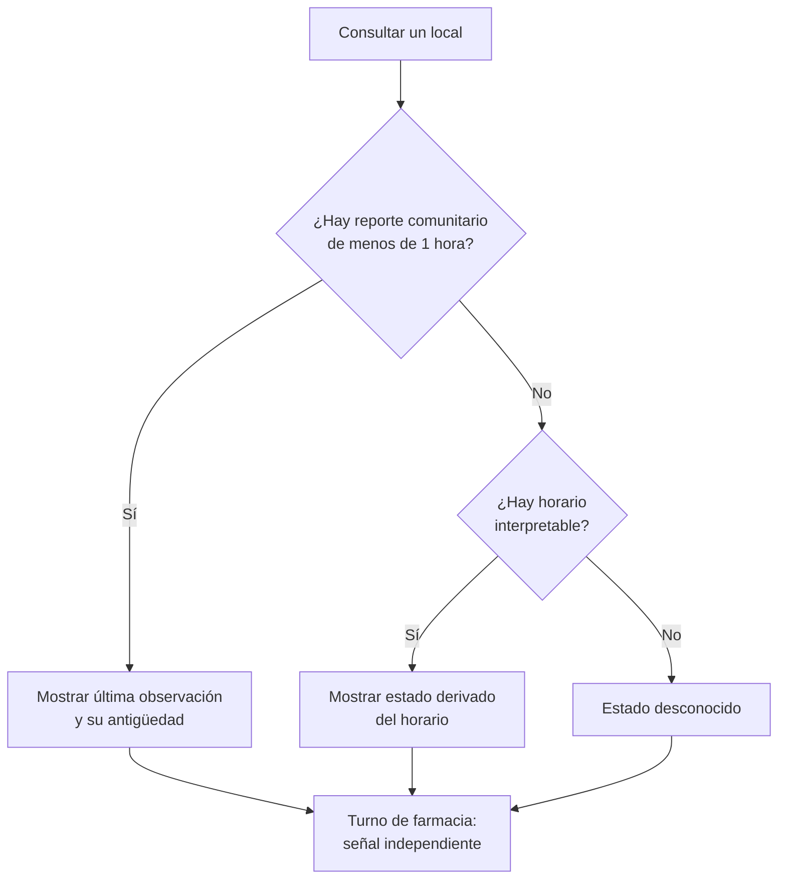

<div align="center">

<picture>
  <source media="(prefers-color-scheme: dark)" srcset="branding/banners/cumpita-banner-oscuro.svg" />
  
</picture>

# cumpita.

**Antes de salir, averigua si vale la pena el pique.**

Una PWA para consultar locales cercanos, contrastar horarios y compartir lo que acabas de observar.

[](docs/desarrollo/03-evolucion.md)
[](docs/tecnica/03-reglas-y-flujos.md)
[](docs/tecnica/04-integraciones-y-resiliencia.md)
[](LICENSING.md)

[**Probar Cumpita**](https://cumpita.lovable.app) · [**Cómo usarlo**](docs/general/02-experiencia-de-uso.md) · [**Documentación**](docs/README.md) · [**Estado y límites**](docs/desarrollo/02-operacion-calidad-y-seguridad.md)

</div>

---

## ¿Por qué hice Cumpita?

La idea comenzó con una conversación con mi padre: salir a comprar algo y descubrir, solo al llegar, que el negocio está cerrado. Quise responder una pregunta cotidiana: **¿vale la pena salir ahora?**

Para eso decidí combinar **datos publicados** con **observaciones recientes de las personas**. Un horario puede estar desactualizado y un reporte también puede equivocarse; por eso Cumpita muestra señales, fuentes y antigüedad en lugar de prometer que un local estará abierto cuando llegues.

Es mi proyecto personal e independiente. Lo desarrollo iterando con **Lovable**, revisando y ajustando los cambios. La participación sin cuenta es una decisión deliberada: quiero que avisar de un local abierto o cerrado sea sencillo, como en otras herramientas comunitarias.

## Qué existe hoy

| Función | Disponible | Límites relevantes |
| --- | --- | --- |
| **Descubrir locales** | Lista, filtros y mapa en Calama, La Serena y Coquimbo; GPS opcional | Cobertura y actualidad dependen de fuentes externas y zonas consultadas |
| **Ver disponibilidad** | Horarios, turnos de farmacia y observaciones comunitarias recientes | Una señal **no garantiza** el estado al llegar |
| **Reportar abierto/cerrado** | Aportes sin cuenta con ubicación y controles del navegador | Verificación de proximidad y límite anónimo **no están reforzados íntegramente en servidor** |
| **Proponer cambios** | Horarios y lugares, con revisión administrativa | Algunas categorías ofrecidas por la interfaz aún chocan con restricciones SQL |
| **Personalizar la experiencia** | Favoritos locales, instalación PWA y avisos web opcionales | Los favoritos no se sincronizan; push requiere permisos y configuración |
| **Cuenta opcional** | Puntos y funcionalidades vinculadas a sesión | **No** se exige cuenta para consultar ni para enviar un reporte ordinario |

<details>
<summary><strong>Ver cómo se interpreta una señal de apertura</strong></summary>



Un reporte deja de influir en el estado visible al cumplir una hora, **aunque el registro pueda seguir en la base**. Un turno no equivale a una garantía de atención. [Reglas y estados](docs/tecnica/03-reglas-y-flujos.md).

</details>

## Estado real del piloto

| Estado | Alcance |
| --- | --- |
| **Implementado** | Consulta y agregación de lugares, reportes sin cuenta, moderación de propuestas, caché, mapa, PWA y flujos de aviso condicionados |
| **En validación** | Precisión de datos, seguridad frente a abuso anónimo, diferencias entre validadores de UI y SQL, permisos reales de push y accesibilidad |
| **Propuesto / no activo** | Búsqueda con IA en la interfaz, empaquetado Android y posibles ampliaciones de cobertura; ninguno debe anunciarse como entrega validada |

> **Importante sobre la participación sin cuenta:** un aporte puede guardarse con `user_id = NULL`. Eso evita exigir registro, pero **no significa anonimato absoluto o ausencia de datos técnicos**: la conexión, los permisos de ubicación y los servicios utilizados pueden tratar metadatos. [Detalles del modelo y sus límites](docs/tecnica/02-dominio-y-datos.md).

## Cómo está construido

| Componente | Implementación |
| --- | --- |
| **Interfaz web** | React 19, TypeScript, TanStack Start y Tailwind CSS 4 |
| **Mapa y rutas** | Leaflet, datos/cartografía OpenStreetMap y servicios de rutas externos |
| **Información de locales** | Overpass/OSM, datos MINSAL incorporados, proveedor de turnos y Google Places opcional |
| **Datos comunitarios** | Supabase/PostgreSQL, autenticación opcional, RLS y Realtime |
| **Notificaciones** | Firebase Cloud Messaging mediante conector, cuando está configurado |
| **Distribución** | PWA y funciones de servidor; las GitHub Releases entregan fuentes y notas, no un APK |

La **búsqueda de la interfaz es textual**. Aunque existen `ai-search.*` y una dependencia de SDK de IA, no hay un flujo activo que los invoque para buscar locales. [Arquitectura y fronteras de confianza](docs/tecnica/01-arquitectura.md).

## Ejecutarlo en desarrollo

El proyecto usa **Bun 1.4.3** y Node.js 24 en CI. Con el backend y las variables correspondientes configuradas:

```sh
bun install --frozen-lockfile
bun run dev
```

Para revisar una contribución:

```sh
bun run lint
bunx tsc --noEmit
bun run test
bun run test:release
bun run build
```

El archivo `.env` versionado está destinado a configuración **publicable**; las credenciales privadas deben permanecer en el servidor o en archivos locales ignorados por Git. [Guía completa de instalación](docs/desarrollo/01-entorno-y-despliegue.md).

## Documentación para cada lector

| Ruta | Qué encontrarás |
| --- | --- |
| [**01 · General**](docs/general/01-origen-y-alcance.md) | Historia del proyecto, guía para consultar/reportar e identidad visual |
| [**02 · Técnica**](docs/tecnica/01-arquitectura.md) | Arquitectura C1–C4, datos, estados, reportes, integraciones y fallos |
| [**03 · Desarrollo**](docs/desarrollo/01-entorno-y-despliegue.md) | Entorno, pruebas, seguridad, operación, evolución y atribuciones |

[**Explorar el índice completo de documentación**](docs/README.md) · [**Catálogo de recursos visuales**](branding/README.md)

## Autoría y condiciones de reutilización

Desarrollado como **proyecto personal por Pablo Guzmán**, con **Lovable** como herramienta principal de iteración. La autoría de cada recurso gráfico o dependencia de terceros se considera por separado; publicar el código no permite atribuirse las obras ajenas.

El código y la documentación originales sobre los que el titular puede conceder derechos están bajo [PolyForm Noncommercial 1.0.0](LICENSE), con explicación en [LICENSING.md](LICENSING.md) y avisos en [NOTICE](NOTICE). [Licencias y atribuciones de fuentes externas](docs/desarrollo/06-licencias-y-fuentes.md).

**No se cambian los permisos legales en esta reorganización.**
