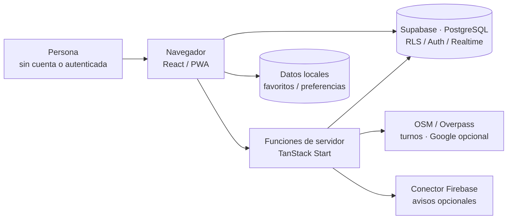

# Documentación de cumpita.

**Una guía para quienes quieren usarlo, comprenderlo o mejorarlo.**

[**Volver a la portada**](../README.md) · [**Abrir la web**](https://cumpita.lovable.app) · [**Guía de uso**](general/02-experiencia-de-uso.md) · [**Estado actual**](desarrollo/02-operacion-calidad-y-seguridad.md)

---

## Tres áreas, tres formas de leer el proyecto

| Área                | ¿Qué explica?                                                                            | Primera lectura                                               |
| ------------------- | ---------------------------------------------------------------------------------------- | ------------------------------------------------------------- |
| **01 · General**    | Por qué nació, cómo se usa y qué decisiones puede tomar una persona                      | [Origen y alcance](general/01-origen-y-alcance.md)            |
| **02 · Técnica**    | De dónde vienen los datos, qué reglas se ejecutan y dónde están los límites de confianza | [Arquitectura](tecnica/01-arquitectura.md)                    |
| **03 · Desarrollo** | Cómo preparar el entorno, verificar cambios, operar el piloto y conservar atribuciones   | [Entorno y despliegue](desarrollo/01-entorno-y-despliegue.md) |

> Cumpita es un **piloto web/PWA**. Reportar sin crear cuenta está implementado; no significa que el servidor compruebe físicamente la ubicación. La búsqueda con IA tiene módulos de código, pero no está disponible en el recorrido de la interfaz.

## 01 · General — la experiencia de la persona

- [**Origen y alcance**](general/01-origen-y-alcance.md) — la conversación que dio origen a Cumpita y su carácter personal.
- [**Experiencia y guía de uso**](general/02-experiencia-de-uso.md) — consulta, GPS, reportes, propuestas, favoritos, turnos y avisos.
- [**Identidad y accesibilidad**](general/03-identidad-y-accesibilidad.md) — búho, banners, estados visibles, contraste y navegación móvil.

## 02 · Técnica — ingeniería y evidencia

| Capítulo                                                                 | Diagramas y decisiones                                            |
| ------------------------------------------------------------------------ | ----------------------------------------------------------------- |
| [Arquitectura](tecnica/01-arquitectura.md)                               | Contexto, contenedores, componentes y despliegue                  |
| [Dominio y persistencia](tecnica/02-dominio-y-datos.md)                  | Modelo de lugar agregado, tablas reales, relaciones lógicas y RLS |
| [Reglas, flujos y estados](tecnica/03-reglas-y-flujos.md)                | Reportes, caducidad, confianza, secuencias y moderación           |
| [Integraciones y resiliencia](tecnica/04-integraciones-y-resiliencia.md) | Proveedores, cachés, fallos y notificaciones opcionales           |

<strong>Ver el mapa general de arquitectura</strong>

La consulta de fuentes externas y ciertas acciones privilegiadas se ejecutan en funciones del servidor. El navegador también llama directamente a Supabase con políticas RLS. Los diagramas más específicos están en los capítulos enlazados arriba.

## 03 · Desarrollo — mantener y comprobar

- [**Entorno, publicación y cron**](desarrollo/01-entorno-y-despliegue.md) — Bun, variables, migraciones y despliegue.
- [**Operación, calidad y seguridad**](desarrollo/02-operacion-calidad-y-seguridad.md) — riesgos reales, moderación y pruebas prioritarias.
- [**Evolución del piloto**](desarrollo/03-evolucion.md) — propuestas diferenciadas de funciones existentes.
- [**Contribuir y versionar**](desarrollo/04-contribuir-y-versionar.md) — iteración con Lovable, convenciones, releases y revisión.
- [**Mapa de rutas**](desarrollo/05-mapa-de-rutas.md) — páginas, rutas de administración y endpoints cron.
- [**Licencias y fuentes externas**](desarrollo/06-licencias-y-fuentes.md) — derechos sobre código, fuentes de datos, atribuciones y pendientes.

## Cómo interpretar el estado

- **Implementado:** hay código y un recorrido identificable, no necesariamente pruebas de producción.
- **En validación:** requiere comprobación de datos, seguridad, accesibilidad o comportamiento en dispositivos.
- **Propuesto / inactivo:** no está disponible aunque existan diseños o archivos preparatorios.
- **Externo:** los datos de terceros pueden cambiar, no responder o presentar condiciones legales propias.

La documentación distingue los **datos obtenidos**, el **estado deducido** y la **observación comunitaria**. Esa distinción importa tanto para el funcionamiento como para la confianza de quien consulta.
