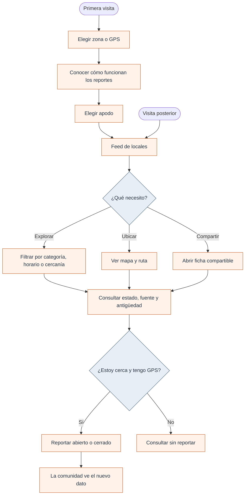

# Experiencia de uso y funciones

## De la duda al local

Al entrar por primera vez se presenta un recorrido de tres pasos: elegir una zona o el GPS, conocer la lógica comunitaria y escoger un apodo. Luego se llega al feed. En visitas posteriores el asistente inicial se omite según una marca guardada en el navegador.

La **cuenta no es obligatoria para reportar**. El apodo del recorrido inicial y una posible sesión autenticada no son requisitos de registro para enviar una observación. Quiero conservar esa baja fricción de participación; los puntos asociados a una cuenta son un recorrido distinto.

## Capacidades y condiciones

| Acción                   | Cómo está planteada                                                                           | Qué hay que tener presente                                                                                                                                       |
| ------------------------ | --------------------------------------------------------------------------------------------- | ---------------------------------------------------------------------------------------------------------------------------------------------------------------- |
| Consultar lugares        | Feed ordenado por distancia, búsqueda textual y categorías                                    | Se muestran hasta 40 resultados en la lista construida por la pantalla; los datos proceden de fuentes y cachés                                                   |
| Ubicarse                 | Zonas manuales o geolocalización                                                              | El permiso GPS es opcional para consultar, pero necesario para habilitar el botón de reporte                                                                     |
| Consultar estados        | Horario, turno disponible o reporte reciente                                                  | Un reporte vence a la hora; el horario publicado puede estar incompleto                                                                                          |
| Reportar abierto/cerrado | No requiere cuenta; las acciones se habilitan a 300 m o menos según la posición del navegador | El control espacial está en la interfaz; no debe considerarse una defensa antifraude del servidor y el límite SQL de 10 min solo afecta a reportes identificados |
| Añadir una etiqueta      | Información breve sobre pago, fila o productos                                                | Algunas etiquetas visibles todavía no tienen soporte en el `CHECK` de la base de datos                                                                           |
| Sugerir un local         | Formulario con advertencia de posibles duplicados                                             | La base de datos solo acepta actualmente dos categorías para nuevas sugerencias                                                                                  |
| Corregir horarios        | Propuesta con nota de evidencia                                                               | La publicación requiere revisión administrativa                                                                                                                  |
| Guardar favoritos        | Preferencia local del navegador                                                               | No se sincroniza automáticamente entre dispositivos                                                                                                              |
| Activar avisos           | Suscripciones, aviso en camino y turnos diarios                                               | Depende de permisos, FCM y de la ejecución del backend y tareas programadas                                                                                      |
| Instalar la PWA          | Funciones del navegador compatible                                                            | No equivale a contar con una APK nativa                                                                                                                          |

La búsqueda con IA no está activada en la interfaz, aunque existen módulos `ai-search.*`. La búsqueda que se usa es textual, normalizada para ignorar tildes y mayúsculas.

## Sobre la confianza del estado

La tarjeta puede ofrecer varias señales a la vez. No se deben mezclar conceptualmente: **“un cumpita lo vio abierto”** no significa **“el horario oficial garantiza que está abierto”**. Si no hay información suficiente, debe mostrarse la incertidumbre.

El mapa ofrece marcadores y puede consultar una ruta externa. Ni el trayecto calculado ni un marcador sustituyen la comprobación física del local.

## Sin conexión

La PWA dispone de service worker y la aplicación conserva una última lista en `localStorage`. Si una consulta falla, puede mostrar esa copia con una indicación de desconexión. **No es una base offline completa ni asegura datos frescos**: depende de que se hayan obtenido lugares previamente y de que la navegación esté disponible en caché.

[Reglas exactas](../tecnica/03-reglas-y-flujos.md) · [Datos y su origen](../tecnica/04-integraciones-y-resiliencia.md)
