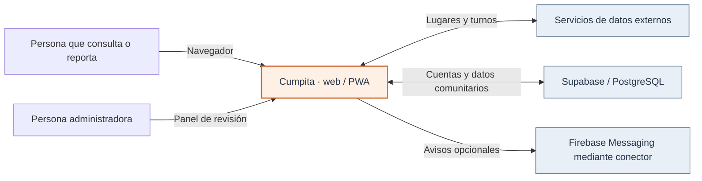
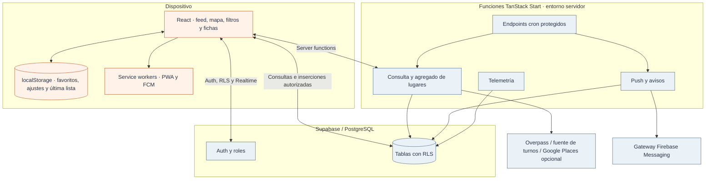
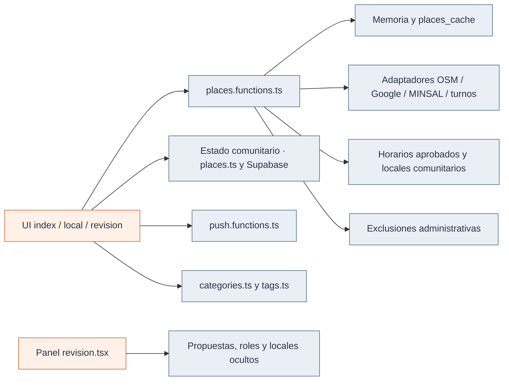
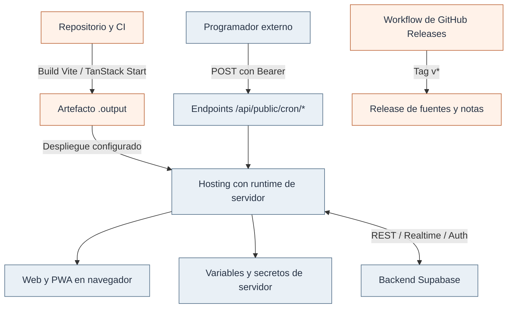

# Arquitectura, de afuera hacia adentro

Cumpita reúne datos de lugares, horarios, turnos y aportes comunitarios. La arquitectura se describe en cuatro niveles: contexto, contenedores, componentes y despliegue.

## Nivel 1 · Contexto

La persona que consulta también puede reportar **sin iniciar sesión**; las cuentas se usan en recorridos específicos y no son un requisito general de participación. El producto no crea por sí mismo un catastro comercial completo: combina fuentes externas, registros locales existentes y contribuciones. Esa dependencia explica por qué **frescura, procedencia y errores** forman parte de la experiencia.

## Nivel 2 · Contenedores y fronteras de confianza

**Fronteras importantes:** el navegador accede a Supabase con una clave publicable y sus políticas RLS; algunas funciones servidor usan `supabaseAdmin` y una clave de servicio capaz de eludir RLS. Esa clave **no** debe exponerse ni al cliente ni a un repositorio. Las funciones que usan privilegios deben validar sus propias entradas y autorización.

`@lovable.dev/vite-tanstack-config` configura la compilación con Nitro y un destino Cloudflare predeterminado. Los servicios y secretos se configuran en el entorno de despliegue.

## Nivel 3 · Componentes de la aplicación

| Módulo                                          | Responsabilidad                                                                |
| ----------------------------------------------- | ------------------------------------------------------------------------------ |
| `src/routes/index.tsx`                          | Pantalla principal, filtros, estado comunitario, suscripciones y acciones      |
| `src/routes/local.$.tsx`                        | Ficha compartible de un lugar                                                  |
| `src/routes/revision.tsx`                       | Revisión de horarios/sugerencias, bajas y telemetría                           |
| `src/lib/places.functions.ts`                   | Consulta, fuente opcional Google, Overpass, MINSAL, caché y agregación         |
| `src/lib/places.ts`, `categories.ts`, `tags.ts` | Tipos de lugar, cálculo geográfico, estados temporales, categorías y etiquetas |
| `src/lib/turnos*.ts`, `botillerias.ts`          | Turnos, horarios y heurísticas específicas                                     |
| `src/lib/push.functions.ts`                     | Registro de avisos y envío a través del conector                               |
| `src/lib/ops.server.ts`                         | Eventos operativos sin coordenadas ni identidad en la estructura del evento    |
| `src/lib/ai-search.*`                           | Módulos existentes de IA, **sin flujo activo de búsqueda** en el UI            |

## Nivel 4 · Despliegue y distribución

Las dos rutas de cron refrescan datos y envían turnos. Un programador externo las invoca mediante POST autenticado. GitHub Releases publica el código fuente y las notas de versión; la web se despliega por separado.

## Decisiones con consecuencias

- **Datos con fechas:** los reportes tienen una vigencia limitada y muestran su antigüedad.
- **Agregación en servidor:** la consulta de lugares necesita un runtime de servidor.
- **Supabase directo desde navegador:** RLS es una frontera de seguridad indispensable para tablas comunitarias.
- **Funciones privilegiadas:** los secretos y la autorización servidor requieren revisión específica, especialmente antes de ampliar el piloto.
- **Búsqueda textual:** los módulos `ai-search.*` están inactivos en el recorrido actual.

[Modelo de datos](02-dominio-y-datos.md) · [Integraciones y fallas](04-integraciones-y-resiliencia.md) · [Despliegue](../desarrollo/01-entorno-y-despliegue.md)
