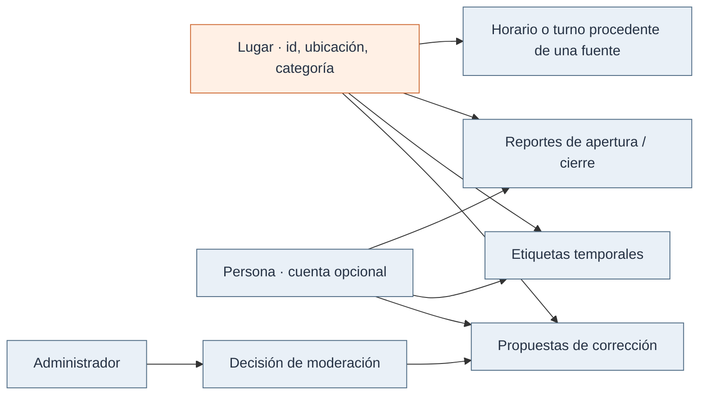
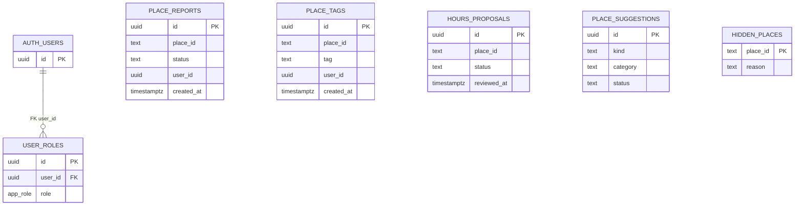
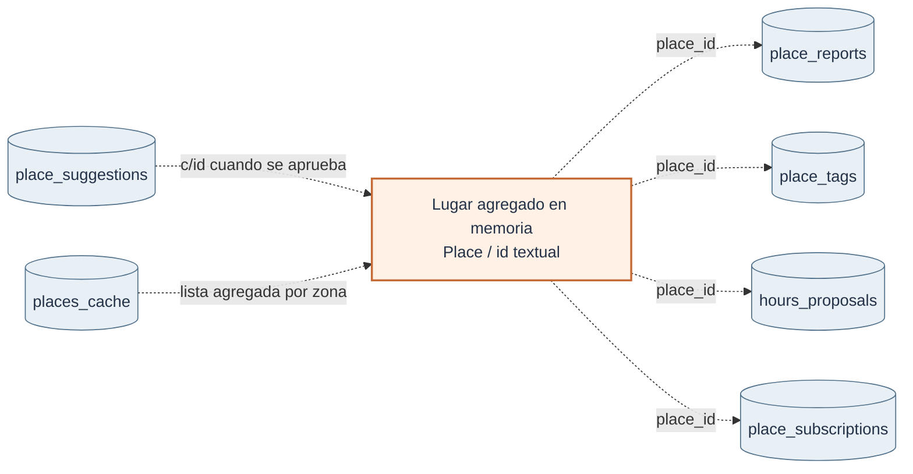

# Dominio, persistencia y modelo de datos

Para razonar sobre Cumpita separo **un lugar**, **lo que una fuente dice sobre él** y **lo que alguien observó**. Que estén unidos en una tarjeta no significa que se guarden en una sola tabla.

## Modelo conceptual

La identidad de una persona es **opcional para un reporte**: `user_id` puede ser `NULL`. Esto permite participar sin cuenta; la puntuación y las funciones asociadas a una sesión son un caso distinto. El anonimato no implica que todos los datos de la aplicación carezcan de identificadores (por ejemplo, suscripciones push).

En el código, `Place` es un objeto de agregación (`src/lib/places.ts`) construido a partir de proveedores y aportes. **No existe una tabla maestra `places`** en las migraciones: los identificadores de locales son textos como `node/…`, `g/…`, `c/…` o `turno/…`. Por eso varias tablas guardan un `place_id` textual **sin clave foránea** a una entidad única.

## Modelo físico de PostgreSQL

Estas son las tablas presentes en las migraciones `0000`–`0013`, no una base de datos imaginada a partir de la interfaz.

| Tabla                 | Guarda                                                      | Acceso o característica relevante                                                                              |
| --------------------- | ----------------------------------------------------------- | -------------------------------------------------------------------------------------------------------------- |
| `place_reports`       | Estado `open/closed`, `place_id`, fecha, `user_id` opcional | Lectura de registros recientes y creación pública; trigger limita frecuencia **solo con usuario identificado** |
| `place_tags`          | Etiqueta, local, fecha y autor opcional                     | Lectura de las últimas 3 horas; el `CHECK` SQL acepta menos etiquetas que TypeScript                           |
| `hours_proposals`     | Horarios propuestos y decisión                              | Escritura pendiente; aprobación mediante rol admin                                                             |
| `place_suggestions`   | Local faltante o feedback y revisión                        | SQL permite sugerencias de categorías `farmacia` o `botilleria`                                                |
| `hidden_places`       | Lugares excluidos de la lista y motivo                      | Lectura del listado para admins; función `get_hidden_place_ids` usada al componer el feed                      |
| `user_roles`          | Asociación de cuenta y rol                                  | Única referencia explícita a `auth.users` en estas migraciones                                                 |
| `cumpita_points`      | Apodo, puntos, cantidad de reportes                         | Escritura de puntos bloqueada al usuario por migración posterior; RPC `award_point` los recalcula              |
| `place_subscriptions` | Cuenta y local seguido                                      | RLS por propietario                                                                                            |
| `place_alerts`        | Alertas en la cuenta                                        | Creación/lectura de su propio usuario                                                                          |
| `en_route`            | Token push, local, vencimiento y secreto                    | Acceso directo reservado a service role                                                                        |
| `turno_subs`          | Token push, ciudad y secreto                                | Acceso directo reservado a service role                                                                        |
| `places_cache`        | Clave de zona, JSON de lugares y actualización              | Caché servidor con permisos de service role                                                                    |
| `ops_events`          | Métricas operativas resumidas                               | Inserción servidor; lectura administrativa                                                                     |

### Relaciones físicas relevantes

Este dibujo representa la **única FK explícita** de la muestra y las estructuras que participan del dominio. Los campos homónimos (`place_id` y otros `user_id`) **no son flechas físicas** si las migraciones no declaran esas restricciones.

### Suscripciones, caché y operación

Se muestran sin relaciones porque la base no declara claves foráneas entre estas tablas. La asociación se resuelve por valores compartidos en el código.

## Referencias lógicas que no son claves foráneas

Además de la FK entre cuentas y roles, muchos registros comparten identificadores en forma de texto o UUID. Estas uniones son **lógicas** (se realizan en consultas/código), no relaciones garantizadas por `FOREIGN KEY`. El siguiente diagrama ayuda a leerlas sin atribuir restricciones que no existen en SQL.

El nombre `place_id` común a varias tablas **no implica integridad referencial automática**. Una futura refactorización podría añadir un catálogo maestro, pero no está implementado en esta versión.

## Persistencia en el dispositivo

`localStorage` mantiene favoritos, apodo de onboarding, preferencias, la última lista de lugares, ventanas de frecuencia de reportes/etiquetas y secretos de suscripciones push. Es almacenamiento del navegador, **no** parte de PostgreSQL, y puede perderse al limpiar datos o cambiar de dispositivo.

## Autorización y evolución del esquema

Las migraciones SQL incorporan `GRANT`, RLS, políticas, funciones y triggers. El archivo `drizzle/schema.ts` aparece vacío en el ZIP; no hay evidencia suficiente para afirmar por qué. **Las migraciones SQL disponibles son la referencia verificable** para el esquema entregado. Los tipos en `src/integrations/supabase/types.ts` ayudan a consumirlo, pero no reemplazan la verificación contra la instancia desplegada.

Antes de introducir una nueva categoría, etiqueta o mecanismo de notificación, hay que modificar juntos la interfaz, los validadores, las restricciones SQL y las pruebas. Las discrepancias observadas están detalladas en la [auditoría](../AUDITORIA.md).

[Reglas del dominio](03-reglas-y-flujos.md) · [Seguridad y operaciones](../desarrollo/02-operacion-calidad-y-seguridad.md)
