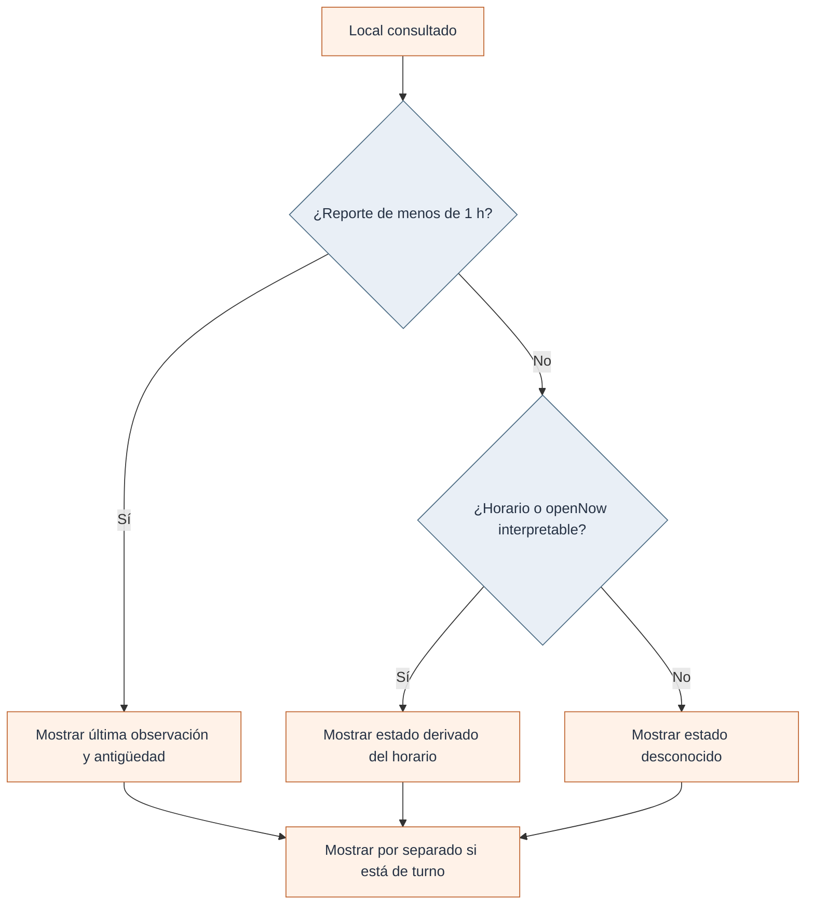
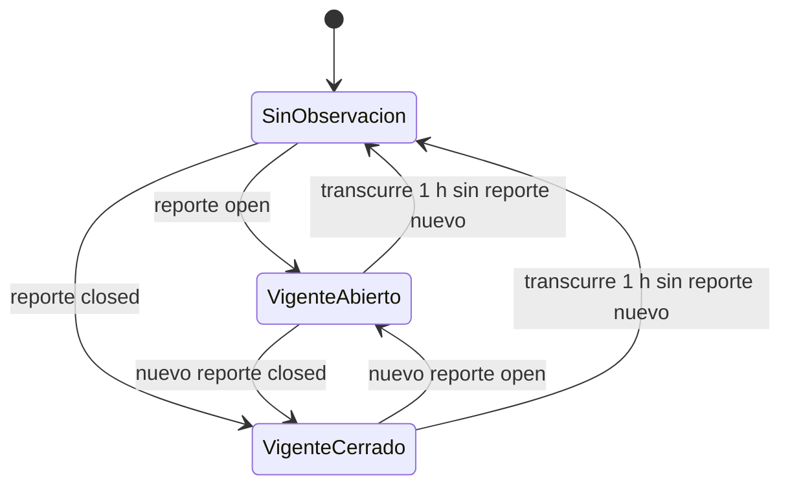
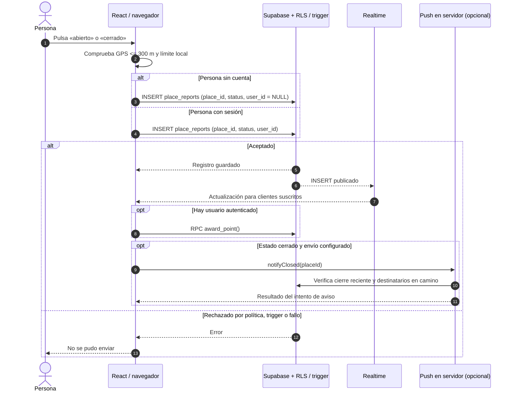
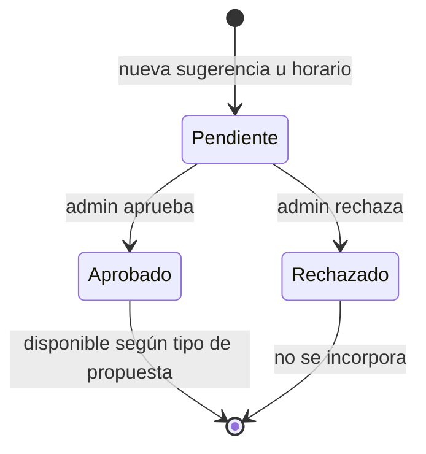

# Reglas, secuencias y estados

El núcleo de Cumpita calcula distancias, combina fuentes y limita la vigencia de la información comunitaria mediante reglas explícitas.

## Reglas de funcionamiento

| Decisión                            | Valor / comportamiento                                                                                                   | Implementación                                           |
| ----------------------------------- | ------------------------------------------------------------------------------------------------------------------------ | -------------------------------------------------------- |
| Distancia                           | Haversine, radio terrestre de 6.371.000 m                                                                                | `src/lib/places.ts`                                      |
| Radio para habilitar reporte        | 300 m a partir de `userPos`                                                                                              | `src/routes/index.tsx`, **cliente**                      |
| Reporte comunitario reciente        | Una hora; se usa el más nuevo                                                                                            | `REPORT_TTL_MS`, `cumpitaStatus`                         |
| Límite entre reportes de una cuenta | 10 min por local en trigger SQL **solo si existe `user_id`**; el navegador impone un límite local también a los anónimos | `0006_security_hardening.sql` y `index.tsx`              |
| Participación sin cuenta            | INSERT público `anon` en `place_reports` con `user_id = NULL` permitido por RLS                                          | Migraciones `0000`, `0006` y `index.tsx`                 |
| Etiqueta comunitaria                | Visible 3 h; 30 min entre envíos de la misma etiqueta desde el navegador                                                 | `tags.ts` y `index.tsx`; **sin trigger equivalente SQL** |
| Detección por permanencia           | Al menos 5 min a menos de 40 m; precisión GPS como máximo 60 m                                                           | `index.tsx`, solo con la aplicación abierta              |
| Sugerencia potencialmente duplicada | Nombre parecido en 400 m o misma categoría en 40 m                                                                       | `SuggestPlace.tsx`, advertencia, no bloqueo definitivo   |
| Aviso «voy en camino»               | Registro con vencimiento de 45 min                                                                                       | `push.functions.ts` y migración `0005`                   |
| Caché de lugares                    | Fresca hasta 6 h                                                                                                         | `places.functions.ts`                                    |
| Caché de turnos                     | Fresca hasta 2 h                                                                                                         | `turnos-live.ts`                                         |
| Carga lenta                         | Mensaje y opción de reintento al cabo de 8 s                                                                             | `index.tsx`                                              |

La distancia de 300 m se comprueba en el navegador; el servidor no verifica la presencia física. El trigger SQL de diez minutos solo limita reportes con `user_id`. Los controles locales pueden eludirse mediante peticiones directas.

## Anonimato como regla del producto

La interfaz envía `user_id: user?.id ?? null`. La política RLS admite inserciones desde el rol `anon` cuando el identificador es nulo, de modo que se puede reportar sin iniciar sesión.

Quedan pendientes los controles de frecuencia en servidor para reportes anónimos. Su implementación debe conservar la participación sin registro y respetar la privacidad.

## Cómo se resuelve el estado visible

Cuando hay un reporte comunitario dentro de su hora de vigencia, el código toma el más reciente y cuenta los reportes de ese mismo estado. Si no hay reporte, el estado puede provenir de horarios aprobados, un estado `openNow` de proveedor u `opening_hours` interpretable. Un turno de farmacia se representa además como **señal de turno**, no como sinónimo universal de apertura garantizada.

Para botillerías sin horario específico, `botillerias.ts` aplica una heurística de cierre con un límite codificado. Ese respaldo requiere mantenimiento y no contiene el horario completo de cada comercio.

## Ciclo de un reporte

El vencimiento es **lógico**: la pantalla deja de usar un reporte después de una hora, aunque la fila siga guardada. Las políticas SQL permiten consultar registros de hasta un día.

Este estado se calcula a partir de los reportes; **no** existe un campo persistente `current_status` en una tabla maestra de locales.

## Secuencia de reporte

Los avisos en primer plano usan Realtime. El envío push requiere permisos, registro del dispositivo y configuración del conector.

## Moderación: propuesta, decisión y visibilidad

Una sugerencia de local aprobada puede entrar al catálogo agregado; una propuesta de horario aprobada modifica la información que se aplica al lugar. Los reportes comunes no pasan por esa cola de revisión.

## Detección pasiva y aviso en camino

La detección pasiva usa la geolocalización mientras la aplicación está abierta y puede generar un reporte `open` después de cinco minutos de permanencia. El aviso en camino guarda temporalmente el token del dispositivo y el local para notificar un cierre reciente.

## Qué debe probarse

La cobertura debe incluir reportes aceptados y rechazados, caducidad, empate de señales, conflicto entre fuente y comunidad, geolocalización denegada, datos desactualizados y participación sin cuenta. Consulta los [casos pendientes](../desarrollo/02-operacion-calidad-y-seguridad.md) para ampliar las pruebas.

[Modelo de datos](02-dominio-y-datos.md) · [Calidad y riesgos](../desarrollo/02-operacion-calidad-y-seguridad.md)
