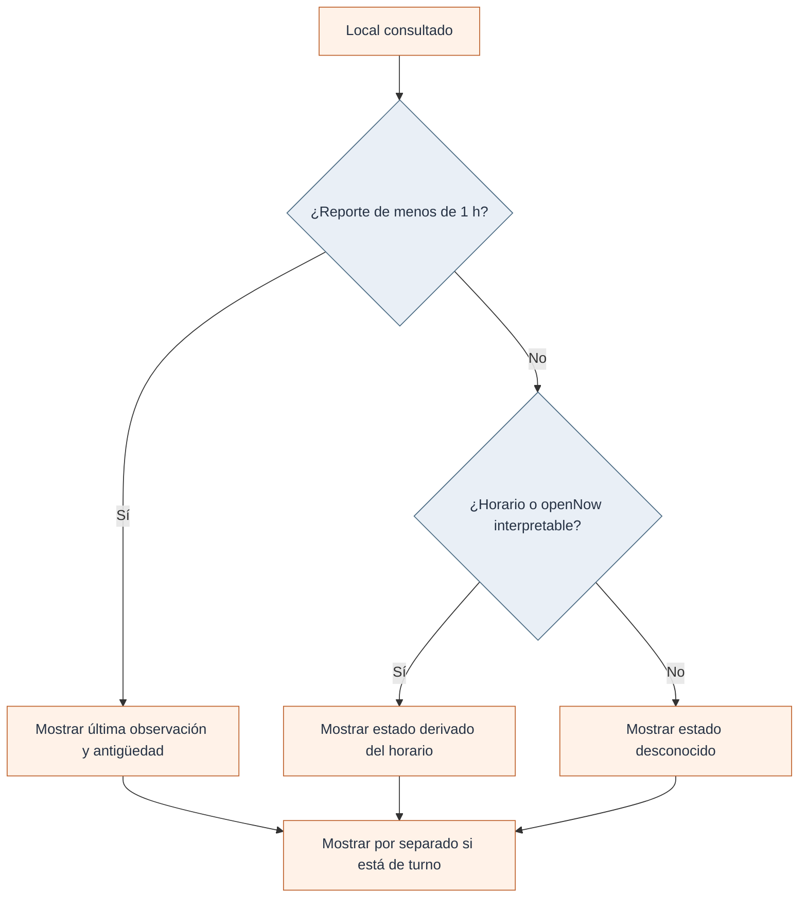
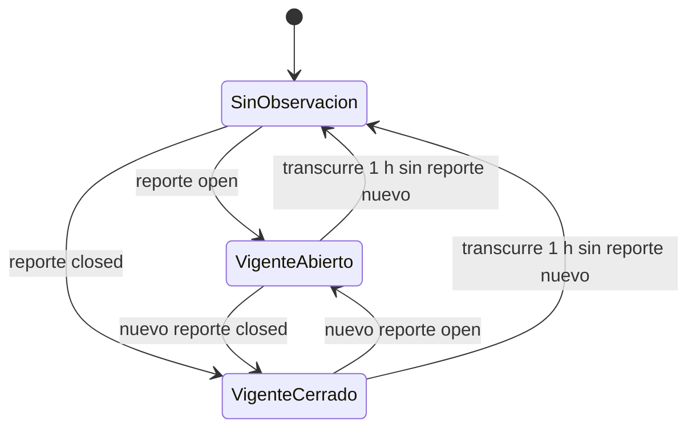
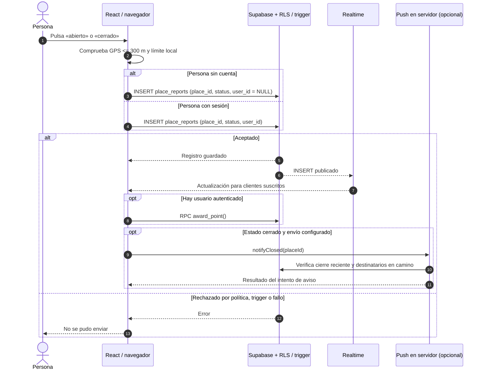
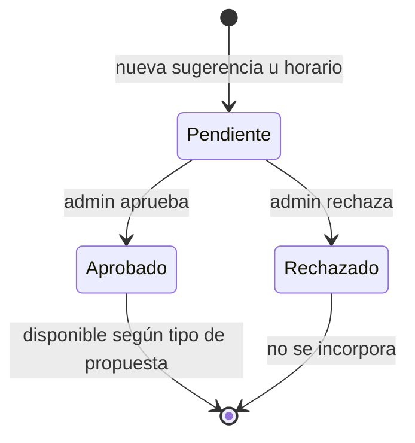

# Reglas, secuencias y estados

El núcleo de Cumpita no es un modelo de IA: son reglas explícitas para calcular cercanía, combinar lugares y limitar la vida de la información comunitaria. Las reglas se pueden seguir en el código, pero sus resultados no deben confundirse con una verificación presencial.

## Reglas verificadas en el código

| Decisión                            | Valor / comportamiento                                                                                                   | Implementación                                           |
| ----------------------------------- | ------------------------------------------------------------------------------------------------------------------------ | -------------------------------------------------------- |
| Distancia                           | Haversine, radio terrestre de 6.371.000 m                                                                                | `src/lib/places.ts`                                      |
| Radio para habilitar reporte        | 300 m a partir de `userPos`                                                                                              | `src/routes/index.tsx`, **cliente**                      |
| Reporte comunitario reciente        | Una hora; se usa el más nuevo                                                                                            | `REPORT_TTL_MS`, `cumpitaStatus`                         |
| Límite entre reportes de una cuenta | 10 min por local en trigger SQL **solo si existe `user_id`**; el navegador impone un límite local también a los anónimos | `0006_security_hardening.sql` y `index.tsx`              |
| Participación sin cuenta            | INSERT público `anon` en `place_reports` con `user_id = NULL` permitido por RLS                                          | Migraciones `0000`, `0006` y `index.tsx`                 |
| Etiqueta comunitaria                | Visible 3 h; 30 min entre envíos de la misma etiqueta desde el navegador                                                 | `tags.ts` y `index.tsx`; **sin trigger equivalente SQL** |
| Detección por permanencia           | Al menos 5 min a menos de 40 m; precisión GPS como máximo 60 m                                                           | `index.tsx`, solo con la aplicación abierta              |
| Sugerencia potencialmente duplicada | Nombre parecido en 400 m o misma categoría en 40 m                                                                       | `SuggestPlace.tsx`, advertencia, no bloqueo definitivo   |
| Aviso «voy en camino»               | Registro con vencimiento de 45 min                                                                                       | `push.functions.ts` y migración `0005`                   |
| Caché de lugares                    | Fresca hasta 6 h                                                                                                         | `places.functions.ts`                                    |
| Caché de turnos                     | Fresca hasta 2 h                                                                                                         | `turnos-live.ts`                                         |
| Carga lenta                         | Mensaje y opción de reintento al cabo de 8 s                                                                             | `index.tsx`                                              |

**Importante:** un control de distancia basado en la geolocalización enviada al navegador **no es garantía antifraude en backend**. Además, el trigger SQL de 10 minutos se aplica si `user_id` no es nulo; los reportes anónimos no están cubiertos por esa misma restricción. La documentación anterior confundía las dos capas.

## Anonimato como regla del producto

Mantener reportes sin registro es una decisión del autor, inspirada en la participación rápida de Waze. En el código, la interfaz escribe `user_id: user?.id ?? null`, y la política RLS admite inserciones desde el rol `anon` cuando el identificador es nulo. **Eso habilita la participación sin cuenta, pero no hace al sistema resistente al abuso**: el trigger de diez minutos no opera para `NULL` y el límite guardado en `localStorage` puede eludirse fuera de ese navegador.

La solución futura debe conservar la publicación sin registro y añadir protecciones en una capa confiable: límites de volumen, detección de patrones anómalos y mecanismos de revisión proporcionales, con cuidado por la privacidad. Estas son recomendaciones, **no características implementadas ni garantías actuales**.

## Cómo se resuelve el estado visible

Cuando hay un reporte comunitario dentro de su hora de vigencia, el código toma el más reciente y cuenta los reportes de ese mismo estado. Si no hay reporte, el estado puede provenir de horarios aprobados, un estado `openNow` de proveedor u `opening_hours` interpretable. Un turno de farmacia se representa además como **señal de turno**, no como sinónimo universal de apertura garantizada.

Para botillerías sin horario específico, `botillerias.ts` introduce una heurística de cierre basada en un límite legal codificado. No debe describirse como validación jurídica actualizada ni inferirse de ella un horario completo de apertura.

## Ciclo de un reporte

El vencimiento es **lógico**: no hace falta borrar la fila exactamente después de una hora para dejar de usarla como confirmación actual. Las políticas SQL permiten consultar reportes de hasta un día, mientras la pantalla filtra a una hora.

Este estado se calcula a partir de los reportes; **no** existe un campo persistente `current_status` en una tabla maestra de locales.

## Secuencia de reporte

La aplicación puede recibir avisos en primer plano mediante Realtime. El envío push, por su parte, exige configuración y registro previos; no está garantizado solo porque exista la función.

## Moderación: propuesta, decisión y visibilidad

Una sugerencia de local aprobada puede entrar al catálogo agregado; una propuesta de horario aprobada modifica la información que se aplica al lugar. Los reportes comunes no pasan por esa cola de revisión.

## Detección pasiva y aviso en camino

Son dos recorridos distintos. El primero depende de la geolocalización continua de una sesión abierta y puede generar un reporte `open` luego de cierta permanencia. El segundo conserva temporalmente un token y un local para enviar aviso si se registra un cierre reciente. Ninguno sustituye la comprobación de proximidad segura en el servidor.

## Qué debe probarse

Como mínimo: un reporte aceptado, otro rechazado, caducidad, empate de señales, conflicto entre fuente y comunidad, geolocalización denegada, datos desactualizados, y creación desde cliente sin cuenta. Las pruebas existentes no cubren todas estas situaciones; son **casos recomendados**, no resultados ya obtenidos.

[Modelo de datos](02-dominio-y-datos.md) · [Calidad y riesgos](../desarrollo/02-operacion-calidad-y-seguridad.md)
