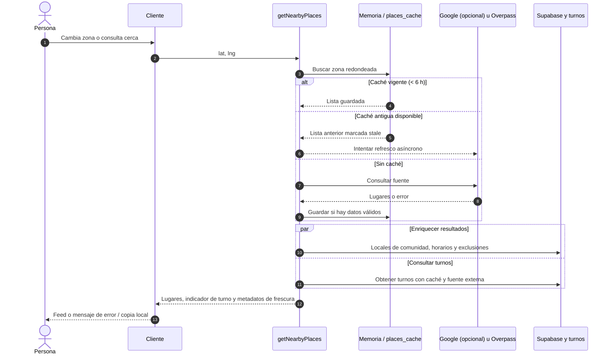
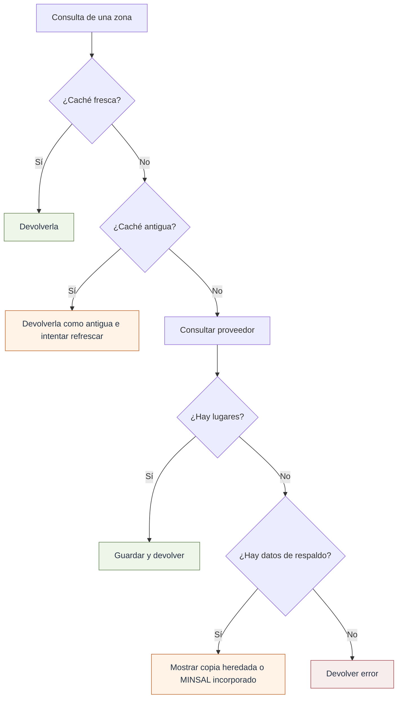

# Integraciones, caché y recuperación

Cumpita trabaja con fuentes que no controlo. Por eso el objetivo no es prometer disponibilidad permanente: es **distinguir una respuesta reciente, una respuesta antigua y una fuente que no respondió**.

## Origen de la información

| Fuente                                      | Qué aporta                                                                  | Condición relevante                                                                     |
| ------------------------------------------- | --------------------------------------------------------------------------- | --------------------------------------------------------------------------------------- |
| **Google Places, opcional**                 | Lugares y estado/horario disponible                                         | Se usa cuando existe `GOOGLE_PLACES_API_KEY`; si falla, vuelve a Overpass               |
| **OpenStreetMap vía Overpass**              | Lugares y etiquetas `opening_hours`                                         | Consulta alrededor de 4 km, con cinco réplicas candidatas y 12 s de límite en el código |
| **Catálogo MINSAL incluido en el código**   | Farmacias y horarios del conjunto embebido                                  | Es una copia incorporada en `minsal-data.ts`, no una consulta viva a la API oficial     |
| **mifarmaciadeturno.cl**                    | Turnos por ciudad a partir de JSON-LD                                       | Consulta externa que puede cambiar formato o fallar; caché de 2 h                       |
| **Calendario de Calama en código**          | Turno calculado cuando se utiliza esa ruta de respaldo                      | Es una rotación local codificada, no una respuesta oficial consultada en ese momento    |
| **Supabase**                                | Reportes, etiquetas, horarios aprobados, sugerencias, bajas, roles y cachés | Las políticas RLS y las claves de servidor delimitan el acceso                          |
| **Leaflet + teselas OSM + OSRM**            | Mapa y cálculo de ruta                                                      | La ruta depende de un servicio externo y no certifica el estado del local               |
| **Firebase Messaging vía conector Lovable** | Avisos web optativos                                                        | Requiere credenciales, dispositivo admitido, token, permiso y backend                   |

No utilizo la IA en la búsqueda activa. Aunque `ai-search.functions.ts` y `ai-search.server.ts` contienen una integración de modelo, `index.tsx` deja el formulario como búsqueda local y no invoca ese servicio.

## Secuencia de consulta y combinación

En caso de caché antigua, el código **intenta** refrescar en segundo plano; su finalización depende de la duración permitida por el runtime. No es una tarea persistente garantizada por una cola. Del mismo modo, los `Promise.race` de consultas auxiliares limitan cuánto espera el agregado, pero no necesariamente cancelan la petición externa subyacente.

## Comportamiento cuando falla algo

La persistencia `places_cache` se almacena por clave de zona (`v3:lat,lng` redondeadas a dos decimales), y también conserva claves de turnos por ciudad. El cliente guarda, por separado, la última lista que obtuvo y puede usarla si la consulta falla.

## Automatizaciones y notificaciones

Los endpoints son **POST** protegidos por un secreto de cron, con posibilidad de rotación del secreto anterior:

- `/api/public/cron/refresh`: consulta turnos e intenta refrescar dos zonas antiguas por ejecución.
- `/api/public/cron/turnos`: recorre ciudades con suscripciones y envía mensajes con turnos disponibles si FCM está configurado.

El horario de invocación —por ejemplo, cada hora o a cierta hora de Chile— **no queda definido en estas funciones**. Debe verificarse en la plataforma que programa las solicitudes. Si se usan expresiones UTC, considerar horario de verano/invierno de `America/Santiago`; una hora UTC fija no equivale a las 20:00 chilenas durante todo el año.

Los avisos «voy en camino» tienen una duración de 45 min y buscan reportes de cierre de los últimos 3 min antes de intentar enviar push. Las suscripciones a un lugar para conocer cuando abre incluyen un mecanismo de aviso en primer plano y de registro en `place_alerts`; no documentaría una entrega push de apertura asegurada en segundo plano sin encontrar y probar esa ruta específica.

## Límites operativos

El registro de `ops_events` incluye `kind`, origen, resultado, duración opcional y detalle corto. No contiene campos de coordenadas o identidad, pero eso no significa que toda la aplicación deje de tratar identificadores: las tablas de suscripción push contienen **tokens de dispositivo** y secretos asociados.

[Arquitectura](01-arquitectura.md) · [Operación y seguridad](../desarrollo/02-operacion-calidad-y-seguridad.md)
